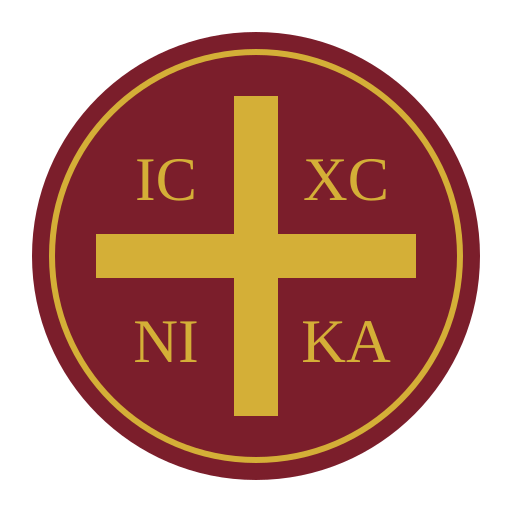

# Awesome Ορθοδοξία 

> Ιστότοποι, κείμενα, μουσική, μέσα ενημέρωσης και λογισμικό της Ορθόδοξης Εκκλησίας, στα ελληνικά.

[🌐 English](../../README.md) · [🇧🇬 Български](../bg/README.md) · [🇬🇪 ქართული](../ka/README.md) · **🇬🇷 Ελληνικά** · [🇲🇰 Македонски](../mk/README.md) · [🇷🇴 Română](../ro/README.md) · [🇷🇺 Русский](../ru/README.md) · [🇷🇸 Српски](../sr/README.md) · [🇺🇦 Українська](../uk/README.md)

Η λίστα περιλαμβάνει πηγές στα ελληνικά από την Ελλάδα, την Κύπρο, το Οικουμενικό Πατριαρχείο και το Άγιον Όρος.

Οι συνεισφορές είναι ευπρόσδεκτες. Διαβάστε πρώτα τις [οδηγίες συνεισφοράς](contributing.md).

## Contents

- [Επίσημοι ιστότοποι](#επίσημοι-ιστότοποι)
- [Ειδήσεις και μέσα ενημέρωσης](#ειδήσεις-και-μέσα-ενημέρωσης)
- [Γραφή και λατρεία](#γραφή-και-λατρεία)
  - [Αγία Γραφή](#αγία-γραφή)
  - [Λειτουργικά κείμενα](#λειτουργικά-κείμενα)
  - [Βίοι αγίων](#βίοι-αγίων)
- [Βιβλία και βιβλιοθήκες](#βιβλία-και-βιβλιοθήκες)
- [Άρθρα και ιστολόγια](#άρθρα-και-ιστολόγια)
- [Βίντεο](#βίντεο)
  - [Κανάλια βίντεο](#κανάλια-βίντεο)
- [Αγιογραφία και εκκλησιαστική τέχνη](#αγιογραφία-και-εκκλησιαστική-τέχνη)
- [Μοναστήρια και προσκυνήματα](#μοναστήρια-και-προσκυνήματα)
- [Θεολογική εκπαίδευση](#θεολογική-εκπαίδευση)
  - [Θεολογικές σχολές](#θεολογικές-σχολές)
- [Εφαρμογές και λογισμικό](#εφαρμογές-και-λογισμικό)
  - [Λογισμικό υπολογιστή](#λογισμικό-υπολογιστή)

## Επίσημοι ιστότοποι

- [Οικουμενικό Πατριαρχείο](https://ec-patr.org) - Επίσημος ιστότοπος του Πατριαρχείου Κωνσταντινουπόλεως.
- [Πατριαρχείο Αλεξανδρείας](https://www.patriarchateofalexandria.com) - Επίσημος ιστότοπος του Πατριαρχείου Αλεξανδρείας και πάσης Αφρικής.
- [Εκκλησία της Ελλάδος](https://www.ecclesia.gr) - Επίσημος ιστότοπος της Ιεράς Συνόδου της Εκκλησίας της Ελλάδος.
- [Εκκλησία της Κύπρου](https://churchofcyprus.org.cy) - Επίσημος ιστότοπος της Αυτοκέφαλης Εκκλησίας της Κύπρου.

## Ειδήσεις και μέσα ενημέρωσης

- [Romfea](https://www.romfea.gr) - Ειδήσεις από την Ορθόδοξη Εκκλησία στην Ελλάδα και στον κόσμο.
- [Orthodox Times](https://orthodoxtimes.gr) - Ελληνική έκδοση του διεθνούς ειδησεογραφικού ιστότοπου Orthodox Times.
- [Ορθοδοξία](https://www.orthodoxianewsagency.gr) - Διεθνές πρακτορείο εκκλησιαστικών ειδήσεων.

## Γραφή και λατρεία

### Αγία Γραφή

- [Ελπήνωρ](https://www.ellopos.net/elpenor/greek-texts/septuagint/default.asp) - Το κείμενο των Εβδομήκοντα με παράλληλη αγγλική μετάφραση.

### Λειτουργικά κείμενα

- [Ελληνικά Λειτουργικά Κείμενα](https://glt.goarch.org) - Μηναίον, Οκτώηχος, Τριώδιον και άλλα λειτουργικά βιβλία στο πρωτότυπο.
- [Digital Chant Stand](https://dcs.goarch.org) - Κείμενα και παρτιτούρες βυζαντινής μουσικής για τις ακολουθίες κάθε ημέρας.

### Βίοι αγίων

- [Ορθόδοξος Συναξαριστής](https://www.saint.gr) - Βίοι των αγίων και εορτές για κάθε ημέρα του έτους.

## Βιβλία και βιβλιοθήκες

- [Αποστολική Διακονία](https://www.apostoliki-diakonia.gr) - Εκδοτικός οργανισμός της Εκκλησίας της Ελλάδος.

## Άρθρα και ιστολόγια

- [Πεμπτουσία](https://www.pemptousia.gr) - Ψηφιακό περιοδικό για τη θεολογία, το Άγιον Όρος και τον ορθόδοξο πολιτισμό.

## Βίντεο

### Κανάλια βίντεο

- [Οικουμενικό Πατριαρχείο](https://www.youtube.com/@ecumenicalpatriarchate) - Επίσημο κανάλι με ακολουθίες και εκδηλώσεις από την Κωνσταντινούπολη.

## Αγιογραφία και εκκλησιαστική τέχνη

- [Βυζαντινό και Χριστιανικό Μουσείο](https://www.byzantinemuseum.gr) - Μουσείο στην Αθήνα με συλλογές εικόνων και βυζαντινής τέχνης.
- [Μουσείο Βυζαντινού Πολιτισμού](https://www.mbp.gr) - Εκθέσεις βυζαντινής τέχνης και ιστορίας στη Θεσσαλονίκη.

## Μοναστήρια και προσκυνήματα

- [Ιερά Μονή Αγίου Ιωάννου του Θεολόγου](https://www.patmosmonastery.gr) - Μονή του 11ου αιώνα στην Πάτμο, μνημείο παγκόσμιας κληρονομιάς της UNESCO.

## Θεολογική εκπαίδευση

### Θεολογικές σχολές

- [Τμήμα Θεολογίας ΕΚΠΑ](https://www.theol.uoa.gr) - Θεολογική σχολή του Εθνικού και Καποδιστριακού Πανεπιστημίου Αθηνών.
- [Τμήμα Θεολογίας ΑΠΘ](https://www.theo.auth.gr) - Θεολογική σχολή του Αριστοτελείου Πανεπιστημίου Θεσσαλονίκης.

## Εφαρμογές και λογισμικό

### Λογισμικό υπολογιστή

- [Neanes](https://www.neanes.com) - Ελεύθερο πρόγραμμα ανοιχτού κώδικα για τη γραφή παρτιτούρων βυζαντινής μουσικής.
